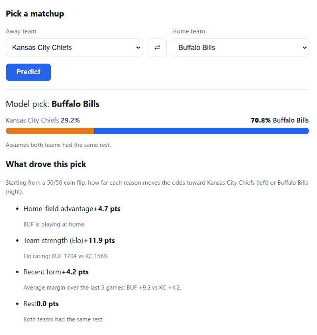
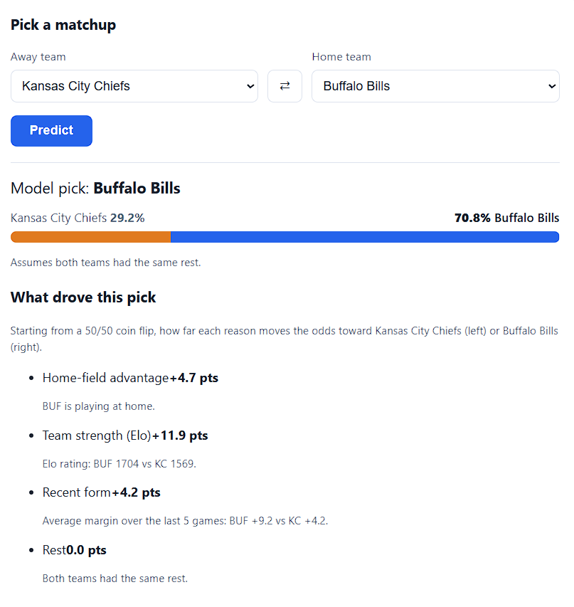

# NFL Game Predictor


A full-stack machine learning app that predicts the winner of NFL games, explains *why*, and keeps score on its own accuracy. Python, scikit-learn, FastAPI, and React, with automated tests, CI, and a scheduled refresh that retrains on the newest results.

**Live demo:** https://nfl-predictor-web.onrender.com/ *(free hosting: the first load after a quiet period can take up to a minute while the server wakes up)*



<details>
<summary>See the full page (upcoming games, accuracy scorecard, power rankings)</summary>



</details>

## Results

Tested on 855 games from the 2023-2025 seasons, which the model never saw during training:

| Model | Accuracy | Log loss |
|---|---|---|
| Always pick the home team (baseline) | 0.549 | n/a |
| Logistic regression, recent-form features | 0.630 | 0.639 |
| **Logistic regression, + Elo ratings (final)** | **0.653** (95% interval 0.620-0.684) | **0.629** |

The 95% interval is the range the true accuracy plausibly lies in, given only 855 games. The whole interval sits above the baseline, so the improvement is not luck.

Features were chosen with **walk-forward validation** (train on all earlier seasons, check on the next one, for 2019-2022), so the test seasons were not used to pick anything:

| Feature set | Accuracy | Log loss |
|---|---|---|
| Recent form (win rate, margin, rest) | 0.621 | 0.6539 |
| + offense/defense averages | 0.618 | 0.6523 |
| + Elo rating | 0.638 | 0.6395 |
| Elo rating only | 0.637 | 0.6399 |
| All features | 0.645 | 0.6385 |

Elo was the only addition that clearly helped. A single Elo number nearly matches everything combined, because it accounts for opponent strength and remembers more than five games.

**The app tracks itself.** Its scorecard predicts the current season's finished games using a model trained only on *earlier* seasons, so those predictions are genuinely out of sample, and it shows a calibration table (when the model says "60-70%", how often does the home team win?). Calibration is reasonable in the middle of the range, and the model is somewhat overconfident about strong away teams. Exact numbers update after every retrain.

## Features

- **Matchup picker:** choose any two teams and get win probabilities.
- **Explanations:** each prediction is broken into four reasons (home field, team strength, recent form, rest), measured in percentage points and averaged over every ordering of the reasons (Shapley-style attribution), so the split is fair and adds up exactly.
- **Upcoming games:** predictions for the next games on the schedule.
- **Accuracy scorecard:** backtest with a confidence interval, current-season results, weekly accuracy, calibration, and recent picks marked right or wrong.
- **Power rankings:** every team's current Elo rating.
- **Always current:** each deploy retrains from the latest data, and a scheduled workflow redeploys every Tuesday and Friday.

## How it works

```
nflverse game data (2015-present)
        |
        v
clean + reshape  ->  one row per team per game
        |
        v
features (all known before kickoff)
  - last-5-game win rate, margin, points scored, points allowed
  - Elo rating (updated after every game, pulled toward average each offseason)
  - rest-day difference
  - each feature is home minus away
        |
        v
StandardScaler -> logistic regression  ->  win probability + explanation
```

**Preventing data leakage.** Every feature uses only information available before kickoff: rolling averages are shifted by one game so a game never sees its own result, and each Elo rating is recorded *before* it is updated. Unit tests check both properties.

**Honest evaluation.** Splits are always by time, never random. Feature choices used walk-forward validation, and the final test seasons were held out.

## Architecture

```
React (Vite)  --HTTP/JSON-->  FastAPI  -->  saved model bundle
 static site                  web service    (model + Elo ratings + recent form + scorecard)

GitHub Actions: lint + tests on every push  |  scheduled refresh -> Render deploy hook
Render: builds the API (installs, trains the model, starts uvicorn) and the static site
```

### API

| Endpoint | Description |
|---|---|
| `GET /` | Health check and model freshness |
| `GET /teams` | All 32 teams with Elo ratings, strongest first |
| `GET /predict?home_team=KC&away_team=BUF` | Win probabilities plus the reasons behind them. Optional `rest_diff` (home minus away rest days) |
| `GET /upcoming?n=16` | Predictions for the next unplayed games |
| `GET /scorecard` | Backtest, current-season results, and calibration |

Interactive documentation is generated at `/docs`. Invalid input returns clear errors (`400`, `404`, `422`).

## Model card

- **Intended use:** learning, demonstration, and casual interest. It is not betting advice, and nobody should rely on it for money decisions.
- **Data:** public game results and schedules from [nflverse](https://github.com/nflverse), 2015 to the present, including playoff games.
- **Model:** logistic regression with six standardized features. Chosen over more complex models because it matched them on this data, trains instantly, and is easy to explain.
- **Known limits:**
  - It sees only past results. Injuries, quarterback changes, weather, and news are invisible to it.
  - About 65% accuracy is near what game results alone can support, and the test set is 855 games, so differences of a point or two between versions are within normal luck.
  - Teams that relocated are merged into one identity, and Elo carries over across seasons with a pull toward average.
  - Predictions for games several weeks away use today's ratings and are less reliable.

## Project structure

```
nfl-predictor/
├── src/
│   ├── data.py          # download games, fix relocated-team names
│   ├── features.py      # rolling form, Elo, feature table
│   ├── model.py         # scaler + logistic regression pipeline
│   ├── evaluate.py      # backtest, live-season scorecard, calibration, confidence interval
│   ├── train.py         # train, evaluate, and save the model bundle
│   ├── predict.py       # predictions and explanations
│   └── api.py           # FastAPI server
├── tests/               # pytest: features, Elo, scorecard math, explanations, API
├── frontend/            # React + Vite app, with Vitest tests
├── notebooks/           # exploration and the original experiments
├── .github/workflows/   # CI and the scheduled refresh
├── requirements.txt
└── requirements-notebooks.txt
```

## Run it locally

```powershell
git clone https://github.com/LSJLiberty/nfl-predictor.git
cd nfl-predictor
python -m venv .venv
.venv\Scripts\Activate.ps1
pip install -r requirements.txt            # add requirements-notebooks.txt for the notebooks

python -m src.train                        # download data, evaluate, save models/latest.joblib
uvicorn src.api:app --reload               # API at http://127.0.0.1:8000  (docs at /docs)
```

In a second terminal:

```powershell
cd frontend
npm install
npm run dev                                # site at http://localhost:5173
```

### Tests and checks

```powershell
python -m pytest -q          # Python tests
ruff check src tests         # lint
cd frontend
npm test                     # React tests
npm run lint
npm run build
```

## Deployment

- **API:** Render web service. Build: `pip install -r requirements.txt && python -m src.train`. Start: `uvicorn src.api:app --host 0.0.0.0 --port $PORT`. Set `ALLOWED_ORIGINS` to the website's address.
- **Site:** Render static site with root directory `frontend`, build `npm ci && npm run build`, publish `dist`, and `VITE_API_URL` set to the API's address.
- **Python version** is pinned in `.python-version`, and Auto-Deploy is set to run only after CI passes.
- **Refresh:** `.github/workflows/refresh.yml` calls a Render deploy hook (stored as the `RENDER_DEPLOY_HOOK_URL` secret) every Tuesday and Friday, which retrains on the newest games.

## What I learned

- **Leakage is the main way ML projects fool themselves.** Shifting features by one game and recording Elo before updating are tested explicitly.
- **Split by time, and don't reuse the test set.** Walk-forward validation picked the features, and the test seasons were scored once.
- **Overlapping features hide in plain sight.** Average margin is exactly points scored minus points allowed, so those weights can't be read individually. Explanations therefore group them into one reason.
- **A clean environment finds bugs your laptop hides.** CI caught a missing dependency (`pyarrow`) that only existed on my machine.
- **Measure calibration, not just accuracy.** A model can pick winners well and still give misleading percentages.
- **Refactor with a safety net.** Moving notebook code into modules reproduced the exact same results (0.653 accuracy, 0.6291 log loss) before anything else changed.

## Ideas for next steps

- Quarterback and injury information, and weather.
- Tune the Elo settings with walk-forward validation, and try gradient-boosted trees.
- Track the live accuracy over time on a chart.
- Rate limiting and caching on the API.

## License and credits

MIT License. Game data from [nflverse](https://github.com/nflverse) via the `nflreadpy` package. This project is not affiliated with the NFL.
